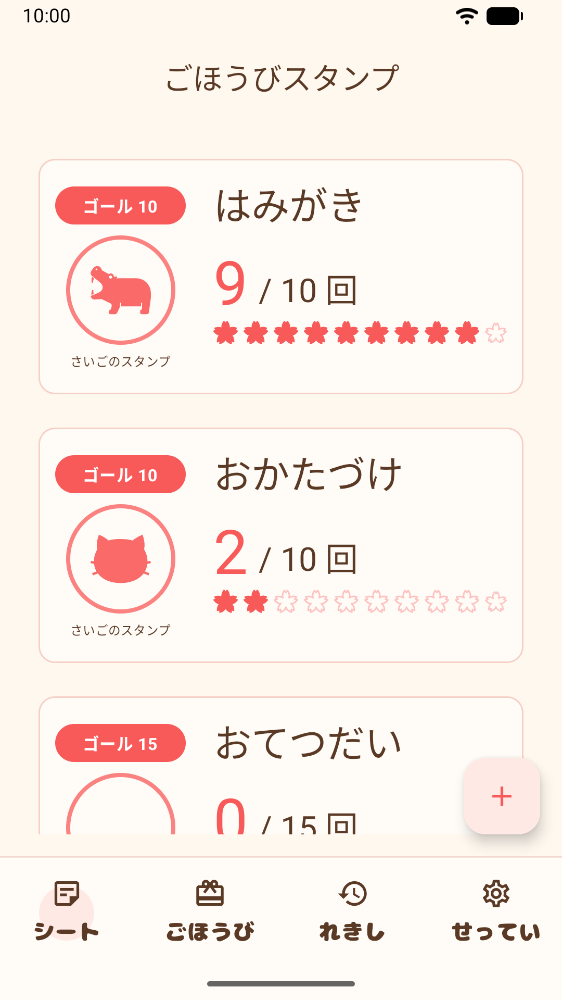
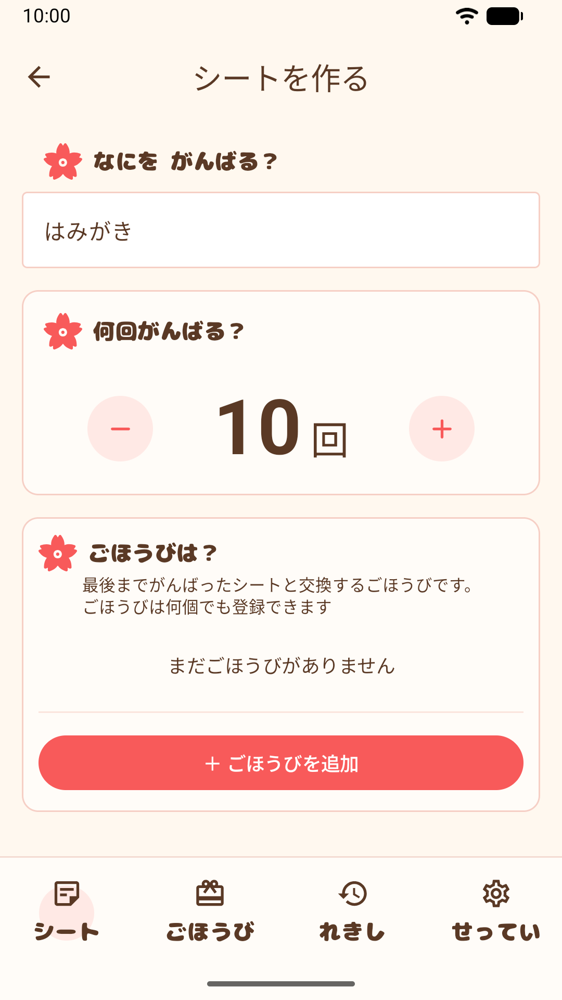
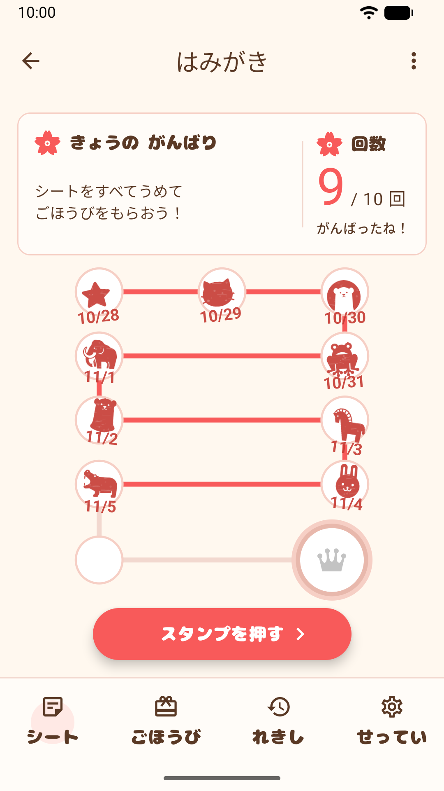
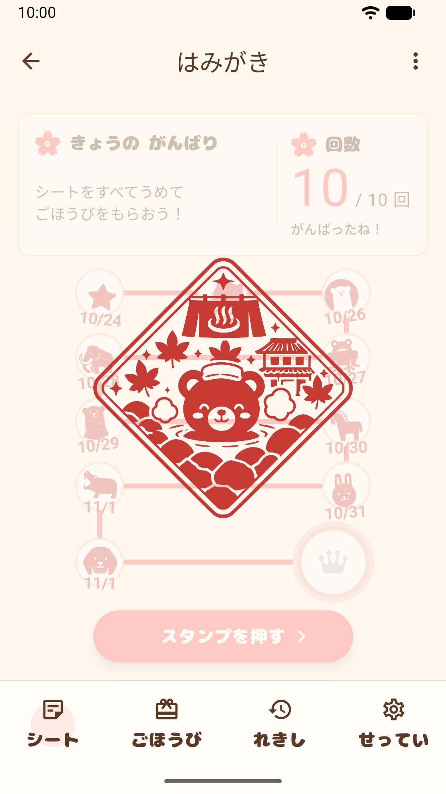
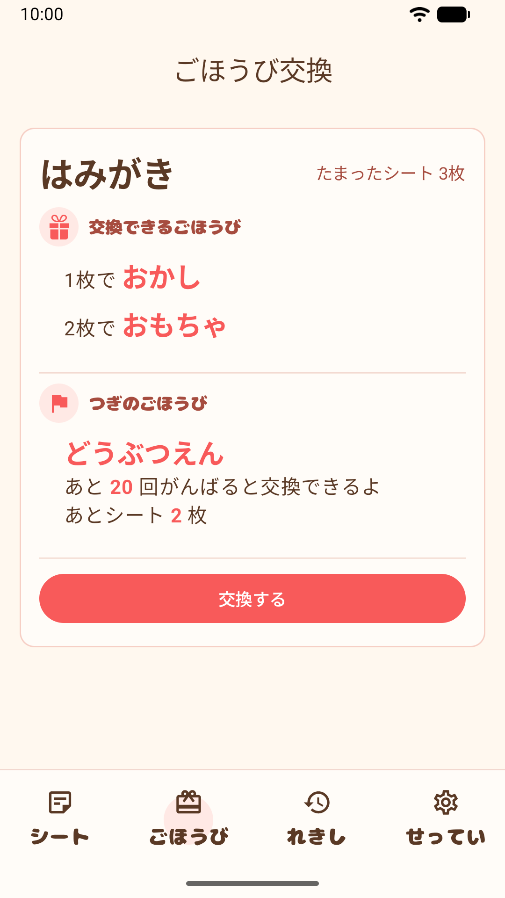
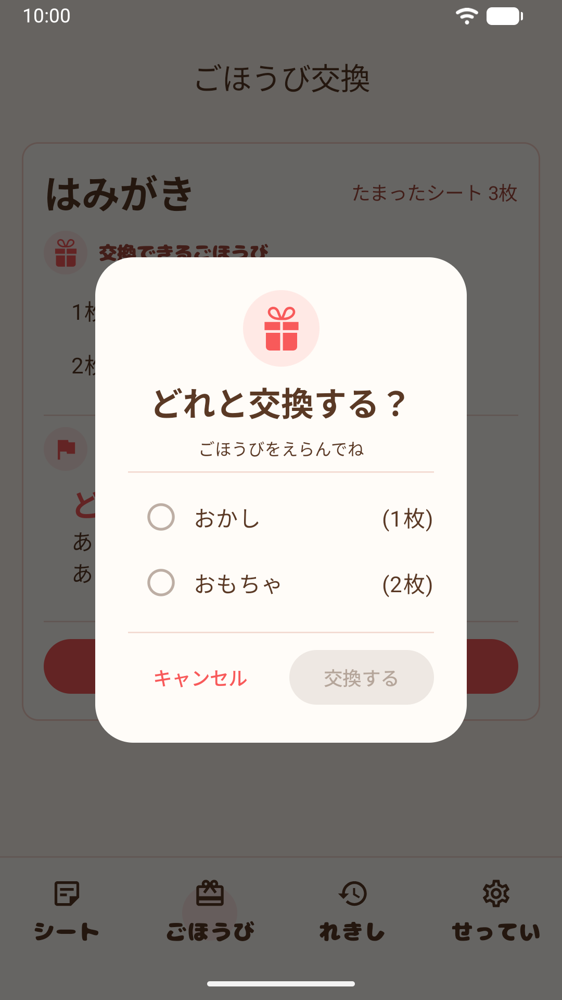
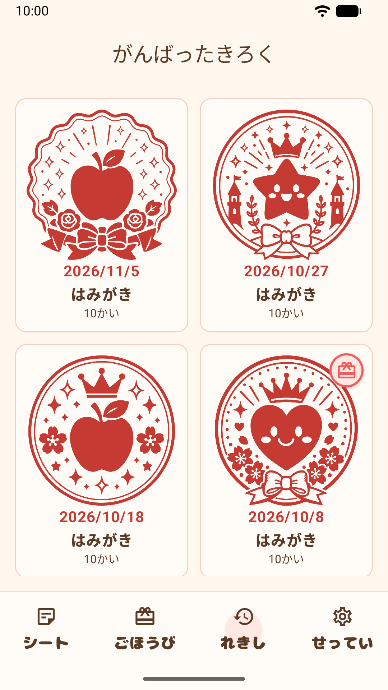
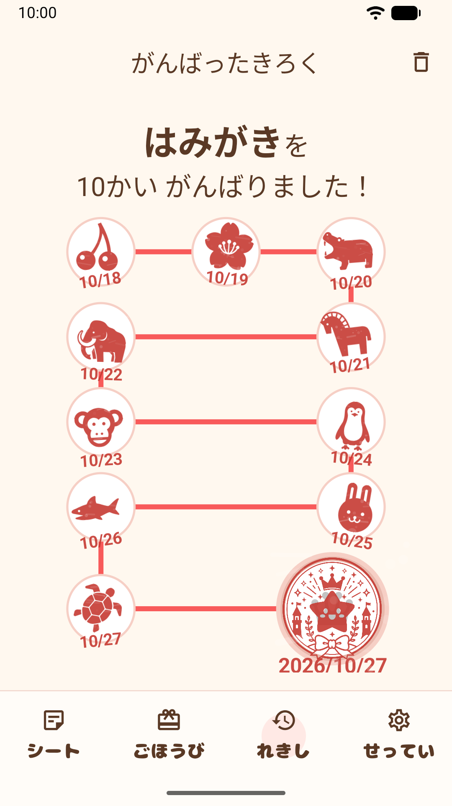
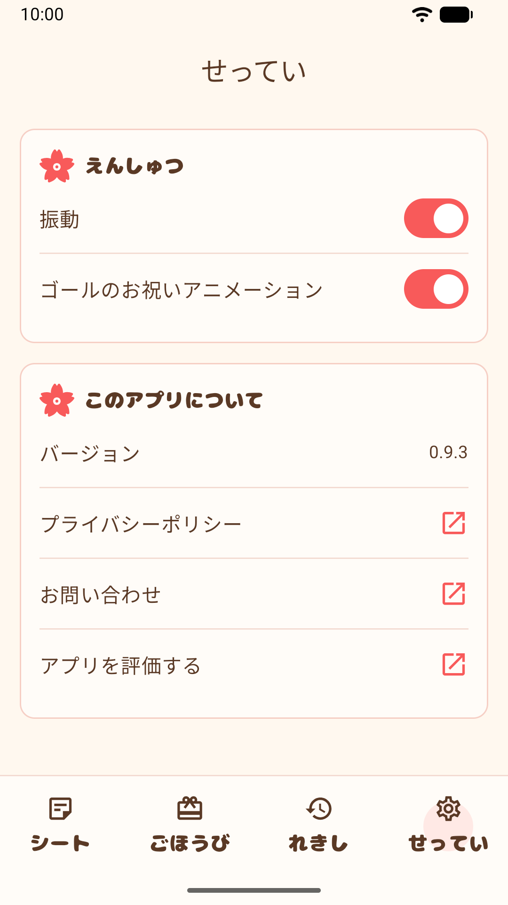

# ごほうびスタンプ

子どもの「がんばった！」を記録する、ごほうびスタンプアプリです。

## 概要

「はみがき」「おかたづけ」「おてつだい」など、子どもが頑張る目標を登録します。

目標を達成すると、ごほうびを受け取るための記録が作成されます。

親子で達成感を共有しながら、楽しく習慣づくりをサポートします。

## Why I built this

紙のごほうびシートは便利ですが、

- 紛失しやすい
- 外出先で使いづらい
- 履歴が残らない

という課題がありました。

そこで、幼児向けに使いやすい
「ごほうびスタンプアプリ」を開発しました。

## 特徴

- スタンプラリー形式で楽しく継続
- ごほうびを設定できる
- 達成履歴を保存
- 幼児でも分かりやすいシンプルなUI
- 広告や課金に頼らないシンプルな体験

## こんな場面に

- はみがき
- おかたづけ
- トイレ
- おてつだい
- おべんきょう

## 主な機能

### シート管理

がんばること、目標回数、ごほうびを登録できます。

| シート一覧                                | シート作成                               |
| ----------------------------------------- | ---------------------------------------- |
|    |    |

### スタンプをためる

スタンプラリー形式で進捗を確認できます。  
ゴールすると特別なスタンプが押されます。

| シート詳細                                | ゴール                                         |
| ----------------------------------------- | ---------------------------------------------- |
|  |   |

### ごほうび交換

達成したシート数に応じて、ごほうびを交換できます。

| ごほうび一覧                         | ごほうび選択                                       |
| ------------------------------------ | -------------------------------------------------- |
|  |   |

### がんばったきろく

達成したシートやスタンプ履歴を振り返れます。

| 一覧                                 | 詳細                                        |
| ------------------------------------ | ------------------------------------------- |
|  |  |

### せってい

振動やゴールのお祝いアニメーションを切り替えられます。

| せってい                              |
| ------------------------------------- |
|  |

## 技術スタック

- Kotlin
- Jetpack Compose（Material 3）
- Navigation Compose
- Room / KSP
- DataStore
- MVVM（ViewModel + StateFlow）
- テスト: JUnit, Robolectric, Paparazzi, Kover
- 品質: ktlint, Detekt, Android Lint, GitHub Actions

## アーキテクチャ

```text
UI (Compose)
↓
ViewModel
↓
Repository
↓
Room (DAO)
↓
SQLite
```

## 開発

```bash
git clone git@github.com:cheesecomer/RewardStamp.git
cd RewardStamp

./gradlew help
./gradlew assembleDebug
```

必要な環境（JDK 21、Android SDK）、テストや静的解析のタスク、コードの決まりごとは [開発ガイド](docs/development.md) にまとめています。

## プライバシーポリシー

[プライバシーポリシー](docs/privacy-policy.md)

## 今後の予定

- 演出強化
- Google Play 公開

## License

このプロジェクトのソースコードは [MIT License](LICENSE) で公開しています。

画像やスタンプなどのアセットは、明示されていない限りライセンス対象外です。

### Credits

スタンプのアイコン（`app/src/main/res/drawable/stamp_*.xml`）は、[SVG Repo](https://www.svgrepo.com/) で公開されている [Icooon Mono](https://www.svgrepo.com/author/Icooon%20Mono/) のアイコンを使用しています。これらのアイコンは PD（Public Domain）ライセンスで提供されています。
